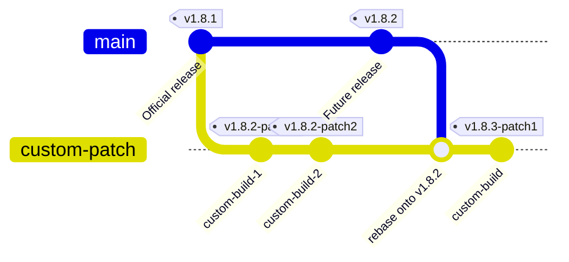

# Harvester Custom Patch ISO Build Runbook

This runbook documents the end-to-end engineering workflow for building a custom Harvester ISO with source-level modifications, packaging local container images into the installer bundle, and executing an in-place cluster upgrade while preserving a clean upgrade path to future official releases.

---

## Custom Versions & Upgrade Eligibility

Harvester relies on two distinct mechanisms to validate and build a custom version:

### Semantic Versioning (SemVer 2.0.0) Precedence Rules

Under **SemVer 2.0.0 Specification **, a pre-release tags like any version with a hyphenated suffix such as `-patch1`, `-rc1`, or `-dev` has **lower precedence** than the associated normal  release version:

$$\text{v1.8.1} < \text{v1.8.2-patch1} < \text{v1.8.2}$$




---

### Build-Time Version Determination

During `make` and `make build-iso`, Harvester executes `scripts/version` inside the Dapper container to compute `VERSION`, `CHART_VERSION`, `APP_VERSION`, `TAG`, and `MIN_UPGRADABLE_VERSION`.

```mermaid
%%{init: {'theme': 'base', 'flowchart': {'curve': 'basis', 'nodeSpacing': 40, 'rankSpacing': 60, 'htmlLabels': true}, 'themeVariables': {'fontFamily': 'Inter, Segoe UI, sans-serif', 'fontSize': '14px', 'lineColor': '#64748b', 'clusterBkg': '#0f172a', 'clusterBorder': '#334155', 'titleColor': '#e2e8f0'}}}%%
flowchart LR
    Start(["<b>Run</b><br/>make / ./scripts/version"])

    subgraph S1["① Verify source"]
        direction LR
        CheckDirty{"<b>Clean tree?</b><br/>git status --porcelain<br/>--untracked-files=no"}
    end

    subgraph S2["② Resolve version"]
        direction LR
        CheckGitTag["<b>Read tag on HEAD</b><br/>git tag -l --contains HEAD"]
        HasTag{"<b>Tag exists?</b>"}
        SetVer["<b>VERSION</b> = v1.8.2-patch1<br/><b>CHART_VERSION</b> = 1.8.2-patch1<br/><b>APP_VERSION</b> = v1.8.2-patch1<br/><b>IMAGE_PUSH_TAG</b> = v1.8.2-patch1"]
        CheckGitTag --> HasTag
        HasTag -- "Yes<br/>(v1.8.2-patch1)" --> SetVer
    end

    subgraph S3["③ Validate upgrade path"]
        direction LR
        LookupMatrix["<b>Query upgrade_matrix.yaml</b><br/>yq: .versions[] | select(.name == VERSION)<br/>| .minUpgradableVersion"]
        MatrixFound{"<b>Match found?</b>"}
        ExportVars(["<b>Export</b><br/> Build ISO"])
        LookupMatrix --> MatrixFound
        MatrixFound -- "Yes<br/>(v1.8.1)" --> ExportVars
    end

    Start --> CheckDirty
    CheckDirty -- "Yes<br/>(clean tree)" --> CheckGitTag
    SetVer --> LookupMatrix

    classDef start fill:#1e293b,stroke:#38bdf8,stroke-width:2px,color:#f8fafc
    classDef decision fill:#312e81,stroke:#818cf8,stroke-width:2px,color:#f8fafc
    classDef action fill:#1e293b,stroke:#38bdf8,stroke-width:1.5px,color:#f8fafc
    classDef success fill:#065f46,stroke:#34d399,stroke-width:2.5px,color:#f8fafc

    class Start start
    class CheckDirty,HasTag,MatrixFound decision
    class CheckGitTag,SetVer,LookupMatrix action
    class ExportVars success

    style S1 fill:#0f172a,stroke:#334155,stroke-width:1.5px,color:#e2e8f0
    style S2 fill:#0f172a,stroke:#334155,stroke-width:1.5px,color:#e2e8f0
    style S3 fill:#0f172a,stroke:#334155,stroke-width:1.5px,color:#e2e8f0

    linkStyle default stroke:#64748b,stroke-width:2px
```


**Three Critical Rules Enforced by `scripts/version`:**
1. **Clean Working Tree Requirement:** `scripts/version` runs `git status --porcelain --untracked-files=no`. If any tracked file (such as `Dockerfile.dapper` or `package/upgrade_matrix.yaml`) has uncommitted modifications, `scripts/version` appends `-dirty` to the version string, breaking Helm chart versioning and image bundling.
2. **Exact HEAD Tag Lookup:** `scripts/version` runs `git tag -l --contains HEAD | head -n 1`. Every time you amend a commit (`git commit --amend`), the commit SHA changes, so you **must** move the tag (`git tag -f v1.8.2-patch1`) to the new `HEAD`.
3. **Upgrade Matrix Enforcement:** When building a release-formatted tag (`v1.8.2-patch1`), `scripts/version` queries `package/upgrade_matrix.yaml` using `yq` to determine `MIN_UPGRADABLE_VERSION`. Your custom tag **must** be added to `package/upgrade_matrix.yaml` before building.

---

## Step-by-Step Implementation Guide

### Step 1: Checkout Base Version & Add Custom Setting
Navigate to your local `harvester` repository and checkout the version tag

example: 
```bash
cd /path/to/harvester
git checkout v1.8.1
```

### Step 2: Implement the Patch
Checkout repository has the capability of changing the harvester cluster controller logic, webhook validations, API schemas, or settings. Implement the needed patch in the repo and well documented commits.

> Note: If you are patching a Harvester extension, follow its image build steps and build the custom image. Before building the ISO, update the extension chart's image reference (repository and tag) to that custom image so the packaged chart deploys it instead of the original controller image.

### Step 3: Register your patch` in `package/upgrade_matrix.yaml`
Open `package/upgrade_matrix.yaml` and add `v1.x.x-patch1` at the top of the `versions` list so `scripts/version` can resolve `MIN_UPGRADABLE_VERSION`

example:
```yaml
versions:
  - name: v1.8.2-patch1
    minUpgradableVersion: v1.8.1
  - name: v1.8.1
    minUpgradableVersion: v1.8.0
```

### Step 4: Create the Tag `v1.x.x-patch1`
Stage all modified files so the Git working tree is completely clean, commit them, and apply the `v1.x.x-patch1` tag

example: 
```bash
git add 
git commit 
git tag -f v1.8.2-patch1
```
Verify your tree is clean before building:

```bash
git status --porcelain --untracked-files=no
# Expected output: (empty)
```

### Step 5: Build Harvester Binaries & Container Images
Run `make` to execute the Dapper build pipeline:

```bash
make
```

Verify that all three Harvester images are tagged in your local Docker daemon:

example: 
```bash
docker images | grep v1.8.2-patch1
```

Expected images:
* `rancher/harvester:v1.8.2-patch1` (and `v1.8.2-patch1-amd64`)
* `rancher/harvester-webhook:v1.8.2-patch1` (and `v1.8.2-patch1-amd64`)
* `rancher/harvester-upgrade:v1.8.2-patch1` (and `v1.8.2-patch1-amd64`)

---

### Step 6: Build the ISO image

With the `v1.x.x-patch1` container images present in your local Docker cache, invoke `make build-iso` to build the image.

example: 
```bash
export USE_LOCAL_IMAGES=v1.8.2-patch1
export HARVESTER_INSTALLER_REF=v1.8.1
make build-iso
```

Once complete, verify your generated ISO and checksum files in `dist/artifacts/`:

```bash
ls -lh dist/artifacts/
```

Expected artifacts:
* `harvester-v1.x.x-patch1-amd64.iso`
* `harvester-v1.x.x-patch1-amd64.sha512`
* `harvester-amd64`
* `harvester-webhook-amd64`

For an extension patch, inspect the extension chart or rendered manifests packaged in the ISO/build output and confirm its controller image reference is the custom repository and tag, not the original image. After installing or upgrading, verify the extension's controller pod reports that custom image in its container spec and runtime `imageID` (for example, with `kubectl -n <namespace> get pods -l <selector> -o jsonpath='{range .items[*]}{.metadata.name}{"\t"}{range .status.containerStatuses[*]}{.name}{"="}{.image}{" imageID="}{.imageID}{"\n"}{end}{end}'`).

---

### Phase 7: Installation Harvester Custom Patch

For a CLI upgrade, use the air-gapped preparation steps in the [Upgrade Plan](harvester-upgrade-plan.md), even when the hosts have internet access. Use the built ISO instead of the official ISO.

In the Version manifest, set `metadata.name` to the custom tag, `spec.isoURL` to the hosted ISO URL, and `spec.isoChecksum` to the bare SHA-512 digest for that ISO from the `.sha512` file. Host the ISO and manifest, then create the Version resource as described in the plan.

Moreover can freshly install harvester using that image as well.
