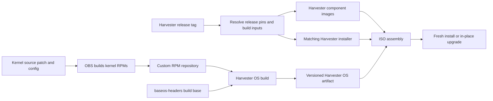
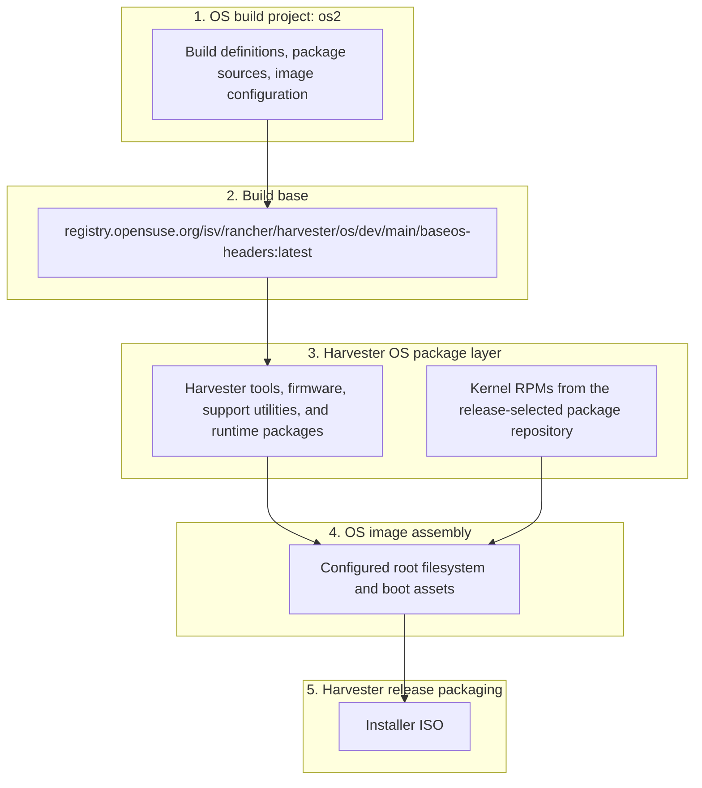
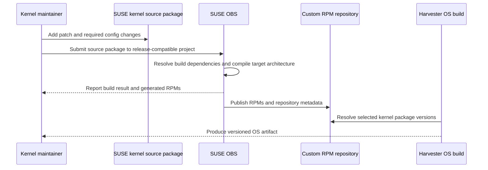

# Harvester Kernel and Base OS Patch Runbook

This runbook explains how a kernel change moves from source to a custom Harvester ISO, and how to validate and upgrade a cluster with that ISO. It complements the [custom patch ISO runbook](harvester-custom-patch-runbook.md), which covers Harvester application images, version metadata, ISO assembly, and the cluster upgrade procedure.

> **Release-specific warning:** Harvester pins installer, OS, kernel, add-on, and image versions in release-specific files and scripts. Use the exact Harvester release branch or tag as the source of truth. File locations, image names, build targets, and OBS projects can change between releases; do not copy a command or pin from another release without checking it.

## The Build Model

Harvester's main repository is the release orchestrator. It resolves the release version, builds or selects versioned Harvester component images, and assembles the ISO using the matching installer and OS inputs. The installer provides the installation workflow and packages the release's installation assets; it is not the kernel source.

The host operating system is a separate artifact path. The OS build uses an OS build environment and package repositories to assemble the node's root filesystem and boot assets. A kernel source patch must be built into RPM packages, published through a repository the OS build can consume, and included in a rebuilt OS artifact before the ISO can contain it.



### Keep the Artifacts Separate

| Input or artifact | What it is responsible for | What it does not do |
|---|---|---|
| Harvester component images | Controller, webhook, upgrade service, and other Kubernetes workloads | Does not replace the node kernel or host OS |
| Installer reference | Release-matched install workflow and installation assets | Does not build a patched kernel |
| Kernel RPMs | Kernel image, modules, and related kernel packages for the target OS and architecture | Are not automatically included just because a custom Harvester image tag exists |
| Harvester OS artifact | The node operating-system filesystem and boot-related content assembled from package inputs | Is not interchangeable with the Harvester controller container images |
| ISO | Packages the installer and the release's OS and component inputs into installable media | Does not prove a custom kernel was selected; inspect the packaged OS input and test the installed node |

In particular, `USE_LOCAL_IMAGES=<tag>` in the ISO workflow selects local Harvester container images. It does **not** select a custom kernel RPM repository or OS artifact. The release-specific OS build and ISO packaging configuration must also point at the rebuilt OS artifact.

## Harvester OS Build Layers

The layers below describe the roles in the build. They are logical stages, not a guarantee that every release uses exactly the same Dockerfile or repository layout.



### 1. `os2` Build Project

The OS build project is the recipe and orchestration layer. It defines which base image to use, which repositories and packages are available, how the root filesystem is assembled, and how the resulting OS artifact is versioned and handed to the Harvester release build. Treat it as build logic, not as the kernel source tree.

For a kernel change, inspect the release's `os2` configuration and the main Harvester repository's OS packaging scripts to find the exact package repository, artifact name, and version pin. A source change that is not selected by those inputs will not reach the ISO.

### 2. `baseos-headers` Build Base

The configured base is:

```text
registry.opensuse.org/isv/rancher/harvester/os/dev/main/baseos-headers:v1.8
```

This is a build/base image used as an input to OS construction. The `headers` variant indicates that it supplies header/build-related content in addition to the base OS environment. It gives downstream build stages a consistent package-manager and repository context. Its exact package contents and purpose should be confirmed from the matching release's image definition; the mutable `latest` tag can change independently of a Harvester release.

Do not confuse this container build base with the final node OS or the ISO. It is an input to the build. Pin or record its immutable digest when reproducibility requires it, and verify that the release's own build definition expects that base.

### 3. Harvester Package Layer

The following package set is the Harvester-specific package layer from the supplied build recipe. The exact list can vary by release.

| Package group | Packages | Role in the node image |
|---|---|---|
| Certificates and system utilities | `ca-certificates`, `ca-certificates-mozilla`, `coreutils-systemd`, `sysvinit-tools`, `sysfsutils`, `augeas`, `augeas-lenses` | Trust stores, common system commands, service/system compatibility, and configuration-file tooling |
| Hardware and diagnostics | `iotop`, `ipmitool`, `kdump`, `supportutils`, `tcpdump`, `traceroute`, `hwinfo`, `usbutils`, `sensors`, `smartmontools`, `fio`, `audit` | Host troubleshooting, hardware inventory and management, crash-dump support, auditing, and storage/network diagnostics |
| Storage and device support | `nfs-utils`, `nvme-cli`, `fcoe-utils`, `xorriso` | NFS client utilities, NVMe management, Fibre Channel over Ethernet utilities, and ISO tooling |
| Firmware | `kernel-firmware-amdgpu`, `kernel-firmware-nvidia`, `kernel-firmware-radeon` | Firmware files for supported GPU hardware; these do not replace the kernel drivers or custom kernel RPMs |
| Kubernetes and virtualization operations | `k9s`, `kubevirt-virtctl`, `qemu-guest-agent`, `helm` | Cluster administration, KubeVirt command-line operations, guest-agent support, and chart management |
| Harvester and shell utilities | `yip`, `yq`, `tmux`, `numactl`, `bind-utils`, `nginx` | Node configuration workflows, YAML processing, terminal sessions, NUMA controls, DNS tools, and HTTP serving used by the platform workflows |
| SELinux integration | `rke2-selinux` | SELinux policy integration for RKE2-related host components |

These are installed OS packages, not all build tools and not all kernel source. In particular, firmware packages can accompany a kernel but do not constitute a kernel patch. Kernel packages must be selected and installed through the OS build's kernel package inputs.

### 4. Kernel Source and RPM Build

The kernel source is maintained separately from the Harvester application repository. For a kernel patch, use the SUSE kernel source and the source branch/package version that matches the Harvester release's OS and kernel baseline. A kernel source package normally brings a spec/build recipe, configuration, and patch series; the build system applies those inputs and produces architecture-specific RPMs.

SUSE Open Build Service (OBS) is the RPM build and publication stage in the workflow described here. OBS builds the source package in a controlled environment and publishes binary RPMs and repository metadata. The Harvester OS build then consumes those RPMs from the configured repository. Verify the actual OBS project, package name, repository, architecture, and release target from the relevant SUSE/Harvester release configuration before submitting a change.



The kernel RPM set must be internally consistent. Depending on the kernel packaging, this may include the kernel image, module packages, development or header packages, and other packages required by the image build. Preserve the expected package names, dependencies, release identifiers, architecture, signing policy, and repository metadata. Do not copy only a `vmlinuz` file into the ISO or node filesystem: package-managed kernel installation also needs the matching modules and boot/initramfs integration expected by the OS build.

## Patch Workflow

### 1. Patch the Kernel Source

1. Check out the SUSE kernel source package/branch corresponding to the Harvester release's kernel baseline.
2. Add the source patch and any necessary kernel configuration change using that source package's conventions.
3. Keep the patch minimal and record its upstream status, rationale, affected architectures, and known hardware dependencies.
4. Build and publish the artifacts using the [Suse Build Service](https://build.opensuse.org)

You may need to create a account in the suse build service account and create a branch of the kernal source repository. Following commands will help you to commit and push the changes to that branch

## Suse Build Service Commands
1. Login to the account

```bash
osc whois
```

2. Branch kernel-source and check it out in one step

```bash
osc branch -c <SOURCE_PROJECT> kernel-source
```

This creates home:sathindud:branches:<SOURCE_PROJECT>/kernel-source and checks it out into the current directory.

To put it in your existing project instead, give a target project:

```bash
osc branch -c <SOURCE_PROJECT> kernel-source home:sathindud:harvester-kernel
```

Pick <SOURCE_PROJECT> from whatever your Harvester base uses. For example:
- openSUSE:Factory or openSUSE:Leap:16.0 (openSUSE kernels)
- Kernel:stable (upstream-tracking kernels)
- SUSE:SLFO:Main (SUSE Linux Micro / Framework One)

You can check that the package exists first with osc ls <SOURCE_PROJECT> | grep kernel.

3. Or branch and check out separately

```bash
osc branch <SOURCE_PROJECT> kernel-source
osc co home"username:branches:<SOURCE_PROJECT> kernel-source
cd home:username:branches:<SOURCE_PROJECT>/kernel-source
```
4. Edit, commit, build

```bash
osc status
osc commit -m ""
osc results
osc buildlog <repo> <arch>
```

### 2. Build the baseos using those published RPMs
Baseos can be found in the following link https://build.opensuse.org/project/show/isv:Rancher:Harvester:OS:Dev. You may need to create a branch and clone it your local machine and do this changes to install the custom RPMs.

```docker
RUN cp -a /etc/zypp/zypp.conf /etc/zypp/zypp.conf.bak && \
    sed -i '/^multiversion =.*$/d' /etc/zypp/zypp.conf && \
    zypper in -y --force --oldpackage --allow-vendor-change 'kernel-default = put the rpm build versoin' && \
    mv /etc/zypp/zypp.conf.bak /etc/zypp/zypp.conf
```

and also update the osc project meta data setting the rpms.

```bash
> osc meta prj -e
<project name="home:username:branches:isv:Rancher:Harvester:OS:Dev">
...
  <repository name="main">
    <path project="home:username:harvester-kernel" repository="Leap_16.0"/>
  </repository>
</project>

```

### 3. Rebuild the Harvester OS Artifact

Update the Dockerfile base os to use your published base os
```docker
FROM registry.opensuse.org/home/username/branches/isv/rancher/harvester/os/dev/main/baseos:latest AS base
```
Run the OS build using the exact command and configuration documented by the selected release's `os2` project with your custom release tag. 

### 4. Integrate with the Harvester ISO Build

1. In the Harvester release checkout, update the OS artifact reference using that release's supported build configuration.
2. Build the versioned Harvester component images as described in the [custom patch ISO runbook](harvester-custom-patch-runbook.md). These images are distinct from the OS artifact.
3. Build the ISO with the release's documented target. Set `USE_LOCAL_IMAGES` for locally built Harvester component images where applicable, but do not treat it as the OS/kernel selector.
5. Inspect build logs and packaged manifests/artifacts to confirm both the custom component image tags and the custom OS artifact were selected.
6. Produce and retain the ISO checksum and the build provenance: source revisions, package versions, base-image digest, OBS build links/IDs, image references, and build logs.

The version tag, upgrade-matrix entry, clean-tree check, local-image handling, and ISO checksum flow are covered in the existing [custom patch ISO runbook](harvester-custom-patch-runbook.md). Apply those controls to this OS change as well; the ISO must describe one coherent custom release.

### 6. Validate Before Cluster Use

Test a fresh installation first where possible, then exercise the in-place upgrade path on a representative non-production cluster. A kernel change affects the boot path and host devices, so a successful ISO build is not sufficient validation.

At minimum, verify:

- The installed node boots without recovery or initramfs errors and reports the expected kernel release with `uname -r`.
- The package database reports the custom kernel RPM versions, for example with `rpm -qa 'kernel-*'` and the package names used by the release.
- Required storage, network, NIC, GPU, and other affected drivers load and function on each supported hardware class.
- Kernel modules match the running kernel; check `modinfo`, `lsmod`, and system logs for unresolved symbols or signature failures as appropriate.
- Node services, RKE2, Harvester workloads, VM launch, storage, and live migration work through node reboot and cluster health checks.
- The upgrade completes node by node, all nodes return `Ready`, VMs and Longhorn volumes recover, and the cluster remains healthy after a second reboot.
- The rollback/recovery path is documented and tested. Keep a known-good ISO and verified backups available.

For an in-place upgrade, use the custom version manifest and upgrade procedure in the [upgrade plan](harvester-upgrade-plan.md), with the custom ISO URL and its bare SHA-512 digest. Do not reuse an official release manifest unchanged if its version name or checksum does not describe the custom ISO.

## Release and Upgrade Considerations

- A custom kernel is a forked release input. Rebase and rebuild it against each new Harvester/SUSE kernel baseline; do not assume an official Harvester upgrade carries the custom patch forward.
- The custom OS artifact and component images must use compatible release identifiers and package inputs. A matching Docker tag does not establish OS compatibility.
- Keep custom RPMs, repositories, ISO, checksum, manifest, and provenance available for the full support lifetime of the custom release.
- Confirm applicable SUSE/Harvester support, security-update, signing, and redistribution requirements before distributing a custom kernel or ISO.
- Treat kernel changes as higher risk than a userspace component image change. Validate on representative hardware and retain a tested recovery route before production rollout.
